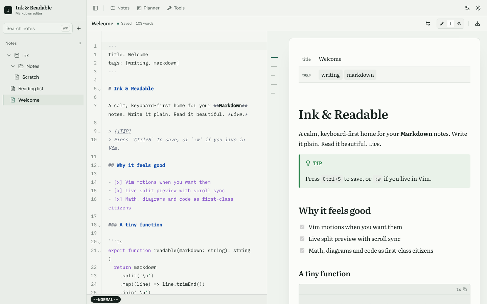

<div align="center">
  
</div>

<div align="center">
  
</div>

<p align="center">
  A calm, keyboard-first home for your Markdown notes.<br>
  Write it plain. Read it beautiful. <em>Live.</em>
</p>

<p align="center">
  Desktop app for macOS, Linux and Windows — built with Tauri 2, Go and React.
</p>

---

## Features

- **Markdown notes, organized in vaults** with a collapsible file tree, create / rename / move / trash and restore.
- **Live split preview** — edit, split or preview-only, with scroll sync between panes.
- **Editor that stays out of the way** — CodeMirror 6, optional Vim motions, relative line numbers, autosave and format-on-save.
- **GitHub-flavored Markdown** — tables, task lists, strikethrough and GitHub alerts (`> [!NOTE]`, `[!TIP]`, `[!WARNING]`…).
- **Diagrams, math and code** — Mermaid diagrams, KaTeX math (`$…$`, `$$…$$`) and syntax-highlighted code blocks with a copy button and language label.
- **Planner** — projects and a drag-and-drop Kanban task board.
- **Developer tools** — JSON → TypeScript/Go types and TypeScript/Go interfaces → Markdown/PDF API docs, and JSON samples or interfaces → JSON Schema, fully offline. See [docs/tools.md](docs/tools.md).
- **Multi-palette theming** — several color palettes with light and dark variants.

## Tech stack

| Layer    | Choices                                                                                                       |
| :------- | :------------------------------------------------------------------------------------------------------------ |
| Shell    | [Tauri 2](https://tauri.app) — native webview + Rust core                                                     |
| Backend  | Go, `net/http`, SQLite, [sqlc](https://sqlc.dev); embedded migrations, run in-process as a Tauri sidecar      |
| Frontend | React 19, TypeScript, Vite, CodeMirror 6, Tailwind CSS 4, shadcn/ui, Vitest                                   |
| Tooling  | Make, pnpm, Oxlint / Oxfmt                                                                                     |

The Go API binary ships inside the app and is launched by the shell on startup
(`--desktop --port 0 --data-dir <app-data>`); it listens on loopback only and is
stopped when the app closes.

## Installation

Download the installer for your OS from
[GitHub Releases](https://github.com/AlvaroVFon/ink-readable/releases).

Releases are **not code-signed or notarized yet**, so the first launch shows the
usual OS warnings. The steps below walk through them.

### macOS

Requires macOS 10.15 (Catalina) or newer.

1. Download the `.dmg` matching your Mac:
   - **Apple Silicon** (M1/M2/M3/…): the `aarch64` build.
   - **Intel**: the `x64` build.
2. Open the `.dmg` and drag **Ink and Readable** into **Applications**.
3. **First launch is blocked by Gatekeeper** — the app is not signed/notarized
   yet (that is planned):
   - *"…can't be opened because Apple cannot check it for malicious software"* →
     right-click (Control-click) the app in **Applications** → **Open** →
     **Open**.
   - *"…is damaged and can't be opened. You should move it to the Trash"* — this
     is the quarantine flag on an unsigned app, **not** real corruption. Remove
     it:
     ```bash
     xattr -dr com.apple.quarantine "/Applications/Ink and Readable.app"
     ```
     If it still refuses, use `xattr -cr "/Applications/Ink and Readable.app"`.
   - On macOS 15+, you can also allow it under
     **System Settings → Privacy & Security → Open Anyway**.

### Windows

Requires Windows 10 or 11 (both ship WebView2).

1. Download either installer:
   - `..._x64-setup.exe` (NSIS), or
   - `..._x64_en-US.msi`.
2. Run it. If SmartScreen appears, click **More info** → **Run anyway**.
3. Launch **Ink and Readable** from the Start menu.

The installer registers an uninstaller under **Settings → Apps**.

### Linux

Requires WebKitGTK 4.1 (present on current distributions; the `.deb`/`.rpm`
packages pull it in). Packages are `amd64`.

- **AppImage (any distribution):**
  ```bash
  chmod +x "Ink and Readable_0.1.0_amd64.AppImage"
  ./"Ink and Readable_0.1.0_amd64.AppImage"
  ```
  If FUSE is unavailable, run it extracted:
  ```bash
  ./"Ink and Readable_0.1.0_amd64.AppImage" --appimage-extract-and-run
  ```
- **Debian / Ubuntu (`.deb`):**
  ```bash
  sudo apt install "./Ink and Readable_0.1.0_amd64.deb"
  ```
- **Fedora / RHEL / openSUSE (`.rpm`):**
  ```bash
  sudo dnf install "./Ink and Readable-0.1.0-1.x86_64.rpm"
  ```

After installing the `.deb`/`.rpm`, launch **Ink and Readable** from your
applications menu, or run `ink-readable` in a terminal.

> **Blank/grey window?** On some GPUs and VMs WebKitGTK needs
> `WEBKIT_DISABLE_DMABUF_RENDERER=1` (and sometimes `GDK_BACKEND=x11`). See
> [Troubleshooting](docs/desktop.md#troubleshooting).

> Once installed, the app checks for new versions on startup and offers to
> update itself in place. Signing (macOS notarization, Windows code-signing) is
> planned. See [`docs/desktop.md`](docs/desktop.md).

## Where your data lives

Everything is local, under the app data directory (no account, no server):

| OS      | Path                                                    |
| :------ | :------------------------------------------------------ |
| macOS   | `~/Library/Application Support/dev.inkreadable.app/data` |
| Windows | `%APPDATA%\dev.inkreadable.app\data`                    |
| Linux   | `~/.local/share/dev.inkreadable.app/data`               |

It contains `ink-readable.db` (SQLite) and `api.log` (backend output). If the app
fails to start, it offers an **Open data folder** action to inspect the log.

### Coming from the old web deployment?

The database format is the same: copy your `ink-readable.db` into the `data`
directory above. Migrations are idempotent and run on startup.

## Development

### Prerequisites

- **Rust** (stable) — <https://rustup.rs>
- **Go** (version in `backend/go.mod`)
- **Node** 24 and **pnpm** 12 (`corepack enable`)
- Linux only, WebKitGTK 4.1 dev packages. On Fedora:

  ```bash
  sudo dnf install webkit2gtk4.1-devel javascriptcoregtk4.1-devel libsoup3-devel \
    gtk3-devel librsvg2-devel openssl-devel
  ```

  (Ubuntu/Debian: `libwebkit2gtk-4.1-dev build-essential curl wget file libxdo-dev libssl-dev libayatana-appindicator3-dev librsvg2-dev`.)

### Run the desktop app

```bash
cd frontend && pnpm install && cd ..
make tauri-dev
```

`make tauri-dev` builds the Go sidecar for your host, then starts Vite and the
Tauri window.

### Frontend-only development (fast loop)

Run the backend and the Vite dev server separately — no Rust needed:

```bash
./scripts/run-backend-dev.sh      # Go API on :8082 (Windows: run-backend-dev.ps1)
cd frontend && pnpm dev           # http://localhost:5173
```

### Docker dev stack (optional)

```bash
make up-dev    # backend + migrations + Vite in containers
make down-dev
```

### Backend (Go) directly

```bash
make build           # build the API binary
make run             # run locally (legacy web mode; needs backend/.env)
make test            # go test ./...
make sqlc-generate   # regenerate typed queries
make migrate-up      # apply migrations with the golang-migrate CLI
make db-reset        # down -all + up
```

### Checks

```bash
make test
cd frontend && pnpm lint && pnpm format:check && pnpm typecheck && pnpm test && pnpm build
```

### Building installers

```bash
make tauri-build     # bundles for the current OS (dmg/app, msi/nsis, deb/rpm/AppImage)
make sidecar-all     # cross-compile the Go sidecar for every desktop target
```

## Release

Tag `desktop-vX.Y.Z` and push; the
[`Desktop Release`](.github/workflows/release-desktop.yml) workflow builds the
sidecar and the installers on macOS (arm64 + x86_64), Windows and Linux, and
attaches them to a **draft** GitHub Release for review.

## Project structure

```text
.
├── assets/              # Screenshots / icon source
├── backend/             # Go API: config, vaults, documents, projects, tasks, editor config
│   ├── cmd/             # entry point (desktop flags + legacy web mode)
│   ├── internal/        # domain, repositories, services, HTTP handlers
│   ├── migrations/      # versioned SQLite migrations (embedded in the binary)
│   └── sqlc/            # SQL queries and generated code
├── frontend/            # React SPA (Vite, CodeMirror, Tailwind)
│   ├── src/
│   └── src-tauri/       # Tauri shell: window, sidecar lifecycle, IPC
├── scripts/             # build-sidecar, run-backend-dev
├── docs/                # specs for the desktop migration
└── Makefile
```

See [`docs/desktop.md`](docs/desktop.md) for the desktop architecture,
[`frontend/README.md`](frontend/README.md) for the data-access layer and
[`backend/README.md`](backend/README.md) for the API architecture.
